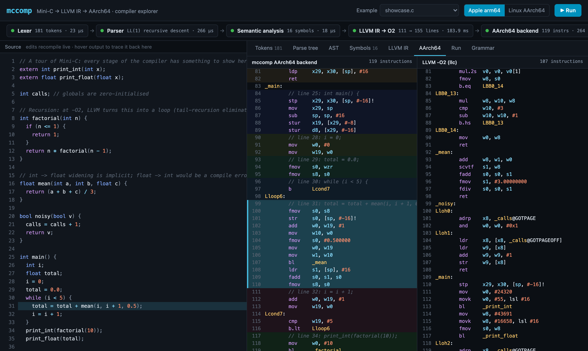
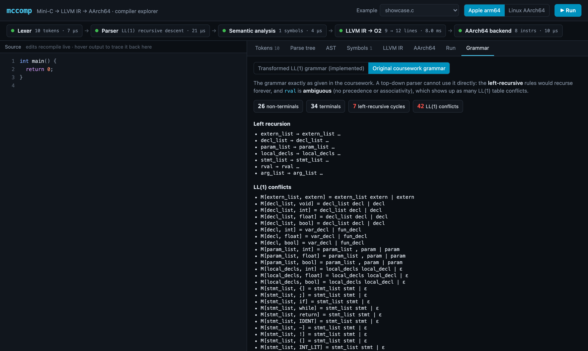
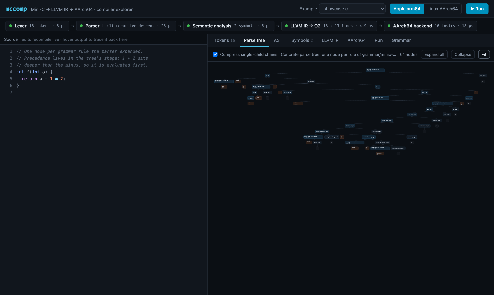
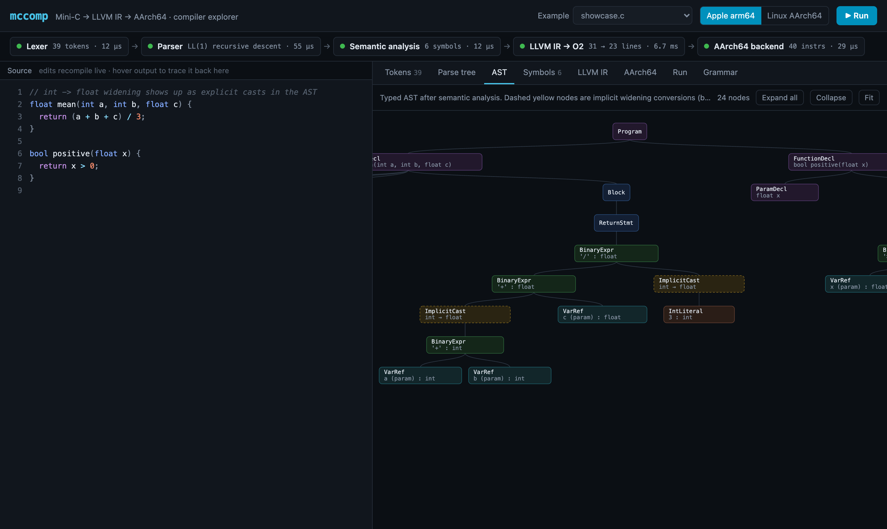
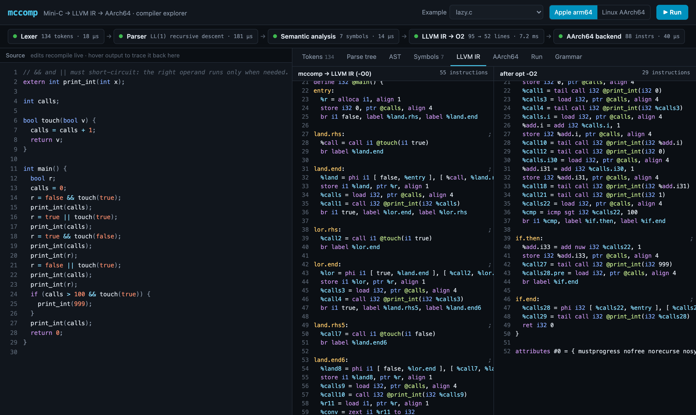
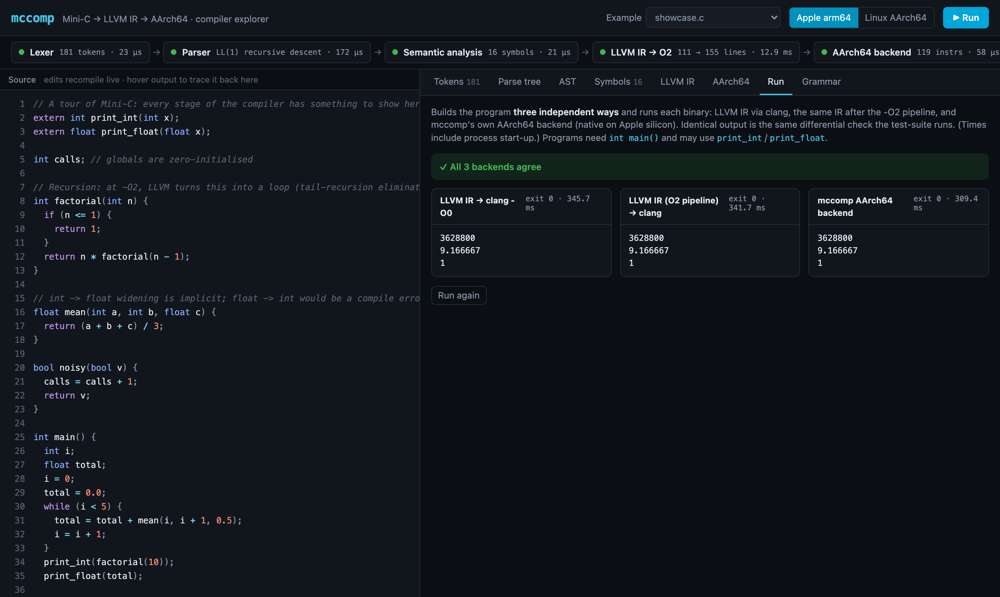
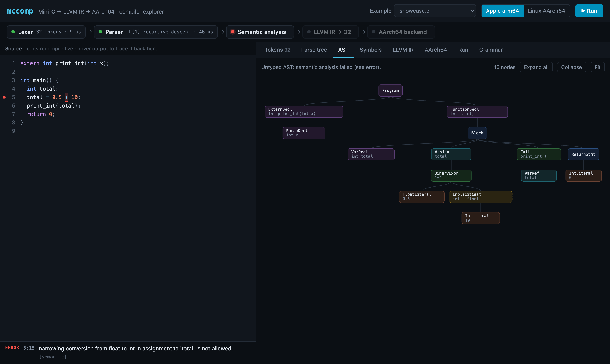
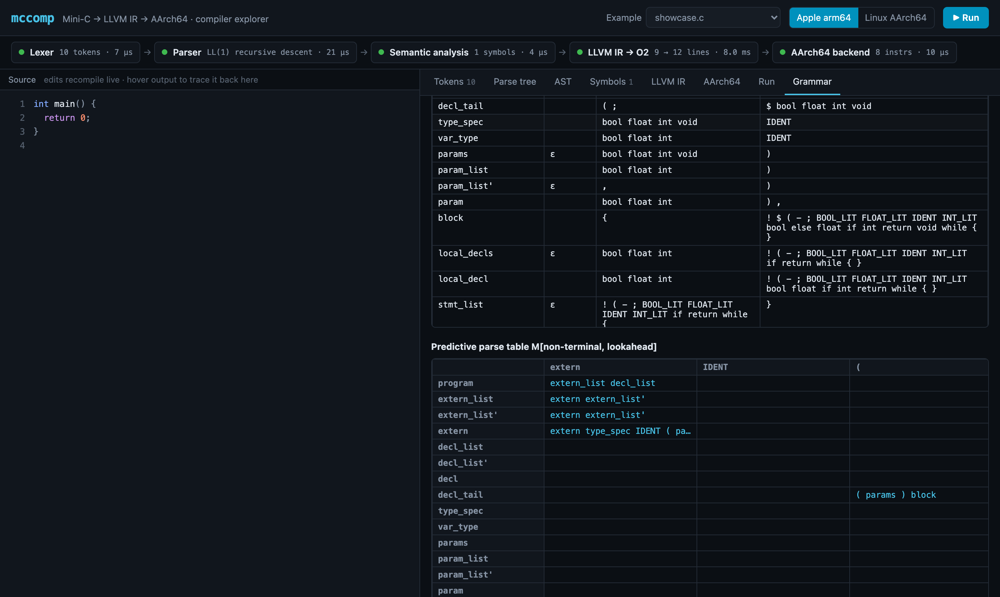

# mccomp: a Mini-C compiler with an LLVM backend and a hand-written AArch64 backend

`mccomp` compiles **Mini-C**, a typed subset of C with `int`, `float`, `bool`, functions, globals, block scoping, `if`/`while` and lazy `&&`/`||`. It has two backends:

1. **LLVM IR.** This is what the coursework required: the compiler writes `output.ll`, which clang can turn into a native binary.
2. **Native AArch64 assembly**, generated directly from the AST without LLVM. It follows the **AAPCS64** calling convention for **Apple arm64** and **Linux AArch64**, and has its own register allocation and peephole optimisations.

Every stage (tokens, parse tree, typed AST, symbol table, IR before and after `-O2`, and both kinds of assembly) can be inspected live in a **web-based compiler explorer**, with links from each output back to the source line it came from.

> **Coursework context.** This started as the coursework for **CS325 Compiler Design** at the University of Warwick (2024), which I passed with **78%**. The brief was a hand-written lexer, a recursive-descent parser, AST printing, semantic checks and LLVM IR generation. This repository is a rewrite and extension of it. The coursework parts are complete and tested. The AArch64 backend, grammar analyser, differential test-suite and visualiser go beyond the brief.



---

## Contents

- [Highlights](#highlights)
- [Quick start](#quick-start)
- [The Mini-C language](#the-mini-c-language)
- [Architecture](#architecture)
- [1. Lexical analysis](#1-lexical-analysis)
- [2. Syntax analysis](#2-syntax-analysis)
- [3. Semantic analysis](#3-semantic-analysis)
- [4. LLVM IR generation](#4-llvm-ir-generation)
- [5. The AArch64 backend](#5-the-aarch64-backend)
- [6. A performance investigation](#6-a-performance-investigation-loop-rotation-made-it-23-slower)
- [7. Testing](#7-testing)
- [8. The compiler explorer](#8-the-compiler-explorer)
- [Course concepts → where they live in the code](#course-concepts--where-they-live-in-the-code)
- [Limitations and future work](#limitations-and-future-work)
- [Repository layout](#repository-layout)

---

## Highlights

| | |
|---|---|
| **Front end** | Hand-written maximal-munch lexer. **LL(1) recursive-descent parser** with one function per rule (44 rules). Typed AST. Scoped symbol table. Type checking that allows widening and rejects narrowing. Clang-style diagnostics with caret positions. |
| **Grammar engineering** | A built-in analyser (`tools/ll1.mjs`) computes nullable/FIRST/FOLLOW sets and the predictive parse table. It shows that the coursework grammar has **7 left-recursive cycles and 42 LL(1) conflicts**, and that the transformed grammar has **0 and 1**. The one remaining conflict is resolved with exactly one extra token of lookahead. |
| **LLVM backend** | IR built with `IRBuilder`, verified with `verifyModule`. Optional `-O2` pipeline (new pass manager) and LLVM's own AArch64 code emission for side-by-side comparison. |
| **AArch64 backend** | ~700 lines of C++, no LLVM involved. Supports AAPCS64 for both Darwin and Linux, including their different stack-argument layouts. Locals are register-allocated into callee-saved registers. Comparisons are fused into conditional branches, AArch64 immediates and `FMOV` immediates are used, and call-free arguments are passed in registers. |
| **Performance** | Matches LLVM `-O2` on a division-heavy benchmark and beats LLVM `-O0` on two of three benchmarks ([numbers](#results)), measured on an Apple M2. |
| **Testing** | 106 automated checks: **19 programs × 3 independent backends** must produce identical output, **28 error programs** must be rejected with the right message, and grammar↔parser consistency is checked. The Linux AArch64 output also runs natively in an arm64 container, built with **GNU binutils**. |
| **Visualiser** | Zero-dependency Node server plus vanilla JS. Shows the pipeline status, token stream, collapsible parse tree and AST, symbol table, IR diff, assembly diff with source mapping, a run button that executes all three backends, and an interactive LL(1) table. |

---

## Quick start

```bash
brew install llvm          # LLVM 23 (Linux: apt.llvm.org, then LLVM_CONFIG=llvm-config-23)
make                       # builds build/mccomp
make test                  # 106 checks: 3 backends × every program, diagnostics, grammar
make web                   # compiler explorer on http://localhost:5325
```

```text
usage: mccomp <file.c | -> [options]

  (no options)        compile to LLVM IR in ./output.ll (the coursework contract)
  --emit=<stage>      print one stage: tokens | parse-tree | ast | symbols |
                      ir | ir-opt | llvm-asm | asm
  --target=<os>       AArch64 flavour for asm/llvm-asm: darwin | linux (default: host)
  -o <file>           write output to <file> instead of stdout / output.ll
  --json              dump every stage as one JSON document
```

Build and run a program with each backend:

```bash
build/mccomp examples/showcase.c --emit=asm -o prog.s     # hand-written AArch64 backend
clang prog.s runtime/runtime.c -o prog && ./prog

build/mccomp examples/showcase.c                          # coursework mode: output.ll
$(brew --prefix llvm)/bin/clang output.ll runtime/runtime.c -o prog && ./prog
```

Other targets: `make bench` (benchmark table) and `make test-linux` (runs the Linux backend in Docker).

---

## The Mini-C language

The grammar comes from the coursework specification ([`grammar/minic.bnf`](grammar/minic.bnf)). The table below lists the semantic rules this compiler enforces:

| Rule | Behaviour |
|---|---|
| Types | `int` (i32), `float` (IEEE single), `bool` (i1). `void` is allowed for functions only. |
| Implicit conversions | **Widening only**: `bool → int → float`. Narrowing (`float → int`, `int → bool`, …) in an assignment, argument or return is a compile error. |
| Arithmetic | Usual arithmetic conversions. `bool` operands are promoted to `int` (`true + true == 2`). `%` works on floats (`fmodf`). |
| Conditions | `if`/`while` conditions and operands of `!`, `&&`, `\|\|` accept any scalar, tested against zero as in C. This is the one deliberate exception to "no narrowing", and it appears as an explicit cast in the AST. |
| `&&` / `\|\|` | **Lazy (short-circuit) evaluation**. |
| Scope | Block scoped, and inner blocks may shadow outer names. Parameters share a scope with the function's outermost block. Redeclaring a name in the same scope is an error. Globals are visible from their declaration onwards. |
| Functions | All signatures are collected before any body is checked, so functions can call each other in any order (mutual recursion). Arity and argument types are checked. |
| Globals | Zero-initialised (LLVM `common` linkage, `.comm` in assembly). |
| Declarations | Locals must come at the start of a block, before any statements. `if`/`else` bodies must be blocks, so the dangling-else ambiguity cannot occur. |

---

## Architecture

```mermaid
flowchart LR
    S[source] --> L[Lexer<br/><i>lexer.cpp</i>]
    L -- tokens --> P[LL&#40;1&#41; parser<br/><i>parser.cpp</i>]
    P -- AST --> A[Semantic analysis<br/><i>sema.cpp</i>]
    P -. parse tree .-> V[(explorer)]
    A -- typed AST<br/>+ casts --> G1[LLVM IR gen<br/><i>codegen_llvm.cpp</i>]
    A -- typed AST --> G2[AArch64 backend<br/><i>codegen_aarch64.cpp</i>]
    G1 --> O[output.ll]
    G1 --> O2[LLVM -O2 → llc]
    G2 --> ASM[.s for Darwin / Linux]
```



Each stage throws a `CompileError {stage, message, line, col}` on the first error. The driver ([`main.cpp`](src/main.cpp)) turns it into a clang-style diagnostic, or into JSON for the explorer. Semantic analysis records its results **on the AST**: every expression gets a type, every name a pointer to its declaration, and every implicit conversion becomes a `CastExpr` node. As a result, neither backend contains any type logic.

| Component | File | Lines |
|---|---|---:|
| Lexer | `src/lexer.{h,cpp}` | 240 |
| Parser | `src/parser.{h,cpp}` | 580 |
| AST + printer | `src/ast.h`, `src/astdump.cpp`, `src/tree.*` | 360 |
| Semantic analysis | `src/sema.{h,cpp}` | 340 |
| LLVM IR generation | `src/codegen_llvm.*` | 340 |
| AArch64 backend | `src/codegen_aarch64.*` | 700 |
| Driver | `src/main.cpp` | 290 |
| Grammar analyser | `web/public/ll1.mjs`, `tools/ll1.mjs` | 230 |
| Explorer | `web/` | 930 |

---

## 1. Lexical analysis

[`src/lexer.cpp`](src/lexer.cpp) is a **hand-coded scanner**. The lectures cover three ways to build a scanner: table-driven, direct-coded and hand-coded. Hand-coding was chosen because Mini-C's token set is small and fixed. Even so, the code still follows the theory:

- **Each token class is a regular language.** Identifiers are `[a-zA-Z_][a-zA-Z_0-9]*`, integers `[0-9]+`, and floats `[0-9]+\.[0-9]*|\.[0-9]+`. The `while (isdigit(peek()))` loops are the hand-written form of the DFA you would get from Thompson's construction followed by subset construction.
- **Maximal munch.** The scanner always takes the longest match: `<=` is one token, not `<` followed by `=`. This is done with one character of lookahead (`two('=', LE, LT)`).
- **Priority.** Keywords are matched as identifiers and then looked up in a keyword table, so `while` becomes `WHILE` and `whilex` stays an `IDENT`. This is the "earlier rule wins" tie-break from the lectures.
- **Error tokens.** Unknown characters and a lone `&` or `|` are reported with a hint (`unexpected '&' (did you mean '&&'?)`) rather than being passed on as junk tokens.
- **Positions.** Every token stores the line and column where it *starts*, so every later diagnostic can point at the exact character.

The original coursework skeleton read from a `FILE*` with global state. This version scans an in-memory buffer, so the same lexer serves the CLI, the tests and the explorer.

---

## 2. Syntax analysis

### 2.1 Transforming the grammar

The specification grammar cannot be parsed top-down as written. The project's own analyser shows this:

```text
$ node tools/ll1.mjs grammar/minic.bnf
grammar/minic.bnf: 26 non-terminals, 34 terminals

Left recursion (7) — a top-down parser would loop forever:
  extern_list ⇒ extern_list
  decl_list ⇒ decl_list
  param_list ⇒ param_list
  local_decls ⇒ local_decls
  stmt_list ⇒ stmt_list
  rval ⇒ rval
  arg_list ⇒ arg_list

LL(1) conflicts (42):
  M[extern_list, extern] = extern_list extern  |  extern
  M[decl, int] = var_decl  |  fun_decl
  ...
```

Three standard transformations produce [`grammar/minic-ll1.bnf`](grammar/minic-ll1.bnf):

**1. Precedence by stratification.** The ambiguous rule `rval ::= rval "||" rval | rval "&&" rval | …` is split into one non-terminal per precedence level, lowest first. A post-order walk of the resulting tree then evaluates operators in the right order:

```text
or_expr  →  and_expr  →  equality_expr  →  relational_expr  →  additive_expr  →  multiplicative_expr  →  unary_expr  →  primary
  ||          &&          == !=              < <= > >=            + -               * / %                   - !
```

**2. Left-recursion elimination.** `A ::= A α | β` becomes `A ::= β A'` and `A' ::= α A' | ε`. For example:

```text
additive_expr  ::= additive_expr "+" multiplicative_expr | multiplicative_expr      (left-recursive)
⇒
additive_expr  ::= multiplicative_expr additive_expr'
additive_expr' ::= "+" multiplicative_expr additive_expr' | "-" multiplicative_expr additive_expr' | ε
```

**3. Left factoring.** Alternatives that share a prefix are split:

| Original (needs k > 1 lookahead) | Left-factored |
|---|---|
| `decl ::= var_decl \| fun_decl` (both start `type IDENT`, so LL(3)) | `decl ::= type_spec IDENT decl_tail`, `decl_tail ::= ";" \| "(" params ")" block` |
| `return_stmt ::= "return" ";" \| "return" expr ";"` | `return_stmt ::= "return" return_value ";"`, `return_value ::= expr \| ε` |
| `primary ::= IDENT \| IDENT "(" args ")"` | `primary ::= IDENT ident_tail`, `ident_tail ::= "(" args ")" \| ε` |

Result:

```text
$ node tools/ll1.mjs grammar/minic-ll1.bnf
grammar/minic-ll1.bnf: 44 non-terminals, 34 terminals

LL(1) conflicts (1):
  M[expr, IDENT] = IDENT = expr  |  or_expr
```

The one remaining conflict is real. `x = 1` and `x + 1` both begin with `IDENT`, and left-factoring `expr` would mean threading an "already consumed an identifier" state through all seven precedence levels. Instead, the parser looks at **one extra token** in this single place: `IDENT` followed by `=` means assignment. All other decisions use one token of lookahead.



### 2.2 The recursive-descent parser

[`src/parser.cpp`](src/parser.cpp) has **one function per non-terminal**, and each function chooses its production by checking the lookahead token against the FIRST sets of the alternatives. An ε-production is taken only when the lookahead is in the rule's FOLLOW set; anything else is a syntax error at that exact token.

Two details matter most:

**Left associativity survives the right-recursive grammar.** After eliminating left recursion, `a - b - c` would naturally be built as `a - (b - c)`, which is wrong. To prevent this, each primed function receives the tree built so far (in attribute-grammar terms, an inherited attribute) and passes the extended tree on:

```cpp
// additive_expr' ::= ("+" | "-") multiplicative_expr additive_expr' | ε
ExprPtr Parser::binaryLevelPrime(int level, ExprPtr lhs) {
  if (LEVELS[level].ops.count(tok().type)) {
    Token op = eat(tok().type, "operator");
    ExprPtr rhs = binaryLevel(level + 1);
    auto node = std::make_unique<BinaryExpr>(op.loc, op.type, std::move(lhs), std::move(rhs));
    return binaryLevelPrime(level, std::move(node));   // ((a - b) - c)
  }
  ...
```

The test [`arithmetic.c`](tests/programs/arithmetic.c) checks that `10 - 3 - 2` evaluates to `5` and `100 / 10 / 5` to `2`.

**FOLLOW sets give useful error messages.** Each ε-decision checks FOLLOW, so the parser can say what it expected. Typical cases also get dedicated messages:

```text
tests/errors/missing_semicolon.c:4:8: error: expected ';' after expression
    4 |   x = 1
      |        ^
tests/errors/decl_after_stmt.c:5:3: error: declarations must appear at the start of a block, before any statements
tests/errors/if_without_braces.c:4:10: error: expected '{' (Mini-C requires braces around if bodies), found identifier 'x'
```

### 2.3 Parse tree vs. AST

The parser can record its **concrete parse tree**: one node per rule expansion, tokens as leaves, and `ε` where an empty production was chosen. A small RAII guard in each parse function builds it. The tree makes the cost of a stratified grammar visible: the three-line function below produces a **70-node** parse tree, because its one expression passes through every precedence level. The AST for the same function has **10** nodes.



The AST keeps only what the meaning needs:

```text
$ mccomp p.c --emit=ast
Program
└─ FunctionDecl int f(int a)  <1:5>
   ├─ ParamDecl int a  <1:11>
   └─ Block  <1:14>
      └─ ReturnStmt  <2:3>
         └─ BinaryExpr '-' : int  <2:12>
            ├─ VarRef a (param) : int  <2:10>
            └─ BinaryExpr '*' : int  <2:16>
               ├─ IntLiteral 1 : int  <2:14>
               └─ IntLiteral 2 : int  <2:18>
```

---

## 3. Semantic analysis

[`src/sema.cpp`](src/sema.cpp) walks the AST once (after a pass that collects function signatures) and **decorates** it:

- **Symbol table as a scope stack.** Each scope is a hash map. Lookup walks from the innermost scope outwards, which gives shadowing for free. Declaring a name already in the *current* scope is an error that points back to the previous declaration. The explorer shows the full table: `global › function › block@line:col`.
- **Name resolution.** Each `VarRef`, `Assign` and `Call` gets a pointer to its declaration, so the backends never look anything up by name. Each `VarDecl` also gets a program-unique id, so two shadowed `x`s can never share storage.
- **Type checking.** Each expression's type is computed bottom-up, the "synthesised attribute" from the attribute-grammar lectures. Expected types flow top-down from assignments, arguments and returns.
- **Implicit conversions are made explicit.** Where a widening is needed, sema wraps the expression in a `CastExpr`. Narrowing is rejected:

```text
$ mccomp e.c
e.c:5:15: error: narrowing conversion from float to int in assignment to 'total' is not allowed
    5 |   total = 0.5 * 10;
      |               ^
```



- **Warnings** for likely mistakes that are still valid Mini-C:

```text
w.c:2:7: warning: assignment used as a condition; did you mean '=='?
w.c:1:5: warning: non-void function 'f' may reach the end without returning a value
```

These use a conservative "all paths return" analysis over `if`/`else` and blocks. There are also warnings for unreachable code after `return` and for integer division by a literal zero.

---

## 4. LLVM IR generation

[`src/codegen_llvm.cpp`](src/codegen_llvm.cpp) generates IR in the style clang uses at `-O0`:

- **Every variable is an `alloca` in the entry block**, with a `load` or `store` at each use. This avoids building SSA by hand: LLVM's `mem2reg`/SROA promote the allocas to registers and place the φ-nodes. Allocas must be in the entry block for that promotion to happen.
- **Control flow becomes explicit basic blocks.** `if` produces `if.then`/`if.else`/`if.end` blocks and `while` produces `while.cond`/`while.body`/`while.end`. Code after a `return` goes into a fresh unreachable block so every block keeps exactly one terminator.
- **Lazy `&&`/`||` turns into control flow and a φ-node.** The right-hand side gets its own block, which only runs when the left side doesn't decide the result:

```llvm
  br i1 %lhs, label %land.rhs, label %land.end      ; false && … skips the call
land.rhs:
  %call = call i1 @touch(i1 true)
  br label %land.end
land.end:
  %land = phi i1 [ false, %entry ], [ %call, %land.rhs ]
```

- **Float semantics follow C.** `<` and `<=` use *ordered* compares (`fcmp olt`: false if either operand is NaN), while `!=` uses *unordered* `une`. [`nan.c`](tests/programs/nan.c) checks all six comparisons against NaN on every backend.
- **Every function is checked** with `verifyFunction`/`verifyModule` before output.

With `--emit=ir-opt`, the module runs through LLVM's new-pass-manager `-O2` pipeline. The recursive factorial in [`showcase.c`](examples/showcase.c) shows how far that goes. Tail-recursion elimination turns the recursion into a loop, and the loop vectoriser then rewrites it as four NEON multiply streams:

```llvm
vector.body:
  %vec.phi = phi <4 x i32> [ splat (i32 1), %vector.ph ], [ %3, %vector.body ]
  %3 = mul <4 x i32> %vec.ind, %vec.phi
  ...
middle.block:
  %8 = tail call i32 @llvm.vector.reduce.mul.v4i32(<4 x i32> %bin.rdx15)
```

---

## 5. The AArch64 backend

[`src/codegen_aarch64.cpp`](src/codegen_aarch64.cpp) turns the typed AST straight into assembly that clang or GNU `as` can assemble. It was written to understand what LLVM's backend does, and to see how close a simple design can get.

### 5.1 Calling convention (AAPCS64)

| Register(s) | Role in AAPCS64 | How mccomp uses them |
|---|---|---|
| `w0–w7` / `s0–s7` | First 8 integer / FP arguments; return value in `w0` / `s0` | Argument passing; `w0`/`s0` is also the expression accumulator |
| `w1`, `w2`, `x9`, `s1`, `s2` | Caller-saved scratch | Binary-operator operands, address computation |
| `w10–w17` / `s16–s23` | Caller-saved scratch | Parking call arguments without touching the stack |
| `x19–x28` / `d8–d15` | **Callee-saved** | **Register-allocated locals**, saved and restored in the prologue/epilogue |
| `x29` / `x30` | Frame pointer / link register | Standard frame record: `stp x29, x30, [sp, #-16]!` |
| `sp` | Must stay **16-byte aligned** at calls | All temporary pushes use 16-byte slots |

Integer and FP arguments are counted separately (the NGRN and NSRN counters in the ABI), so `f(int, float, int)` passes its arguments in `w0, s0, w1`. Arguments beyond eight of a class go on the stack. [`many_args.c`](tests/programs/many_args.c) passes 21 mixed `int`/`float`/`bool` arguments to test this.

### 5.2 Apple vs. Linux

These are two ABIs that look the same at first glance, and the backend implements both:

| | Apple arm64 (Mach-O) | Linux AArch64 (ELF) |
|---|---|---|
| Symbol names | `_main` (leading underscore) | `main` |
| Global address | `adrp x9, _g@PAGE` + `add x9, x9, _g@PAGEOFF` | `adrp x9, g` + `add x9, x9, :lo12:g` |
| Stack arguments | **Packed at natural alignment** (a `bool` takes 1 byte, an `int` 4) | Each argument takes an **8-byte slot** |
| `.comm` alignment | log₂ (`.comm _g,4,2`) | bytes (`.comm g,4,4`) |
| Local labels | `L…` | `.L…` |
| Extras | — | `.type`/`.size`, `.note.GNU-stack` |

### 5.3 Code generation strategy and optimisations

The baseline is an **accumulator machine**: every expression leaves its value in `w0`/`s0`. For a binary operator, the backend evaluates the left side, keeps it, evaluates the right side, and combines them. On top of that baseline:

1. **Register allocation for every local.** Mini-C has no `&` operator, so no variable's address is ever taken, and every local can live in a register for its whole lifetime. Each variable gets a score: its use count, weighted by 8^(loop depth). The highest-scoring variables get `w19–w28` / `s8–s15`. These registers are callee-saved, so they survive calls with no spill code around call sites. Any overflow gets a stack slot.
2. **Operands used in place.** Register-allocated variables and small immediates are used directly as operands: `add w0, w19, #1`, `cmp w0, w20`, `mul w0, w19, w19`. To keep evaluation order identical to the LLVM path, the left operand is only read late when the right side cannot assign to it.
3. **Compare-and-branch fusion.** `if (a < b)` becomes `cmp` + `b.ge else` rather than producing a 0/1 value and testing it. `&&`, `||` and `!` in conditions become chains of branches. Branches are inverted by flipping the condition code. This stays correct for floats because every AArch64 condition code has an exact complement, which matters when operands are unordered: `mi`/`pl` and `ls`/`hi` keep NaN semantics right.
4. **AArch64 immediate forms.** Integers use `mov`/`movz`/`movk`/`movn` sequences. Floats of the form ±(16..31)/16 × 2^(−3..4) use a single `fmov s0, #imm` (the 8-bit FP immediate encoding). Integer `%` uses `sdiv` + `msub`, since AArch64 has no remainder instruction. Float `%` calls `fmodf`.
5. **Register argument passing.** If no argument contains a call, each value is parked in a scratch register and moved into `w0–w7`/`s0–s7`. Because the accumulator is the only source that can overlap a destination, ordering that move first makes the whole parallel move safe.

The resulting inner loop of a prime test:

```asm
Lloop3:                         // while (d * d <= n) { if (n % d == 0) return false; d = d + 1; }
	sdiv	w2, w20, w19        // n in w20, d in w19: no memory traffic at all
	msub	w0, w2, w19, w20    // n % d
	cmp	w0, #0
	b.ne	Lendif6
	mov	w0, #0
	b	Lret_0
Lendif6:
	add	w0, w19, #1
	mov	w19, w0
Lcond4:
	mul	w0, w19, w19
	cmp	w0, w20
	b.le	Lloop3
```

The output includes `// line N:` comments, which the explorer uses to colour each block by its source line, Godbolt-style.

---

## 6. A performance investigation: loop rotation made it 2.3× slower

The first version of the backend kept every variable in a stack slot and **rotated loops**: it put the condition at the bottom, so each iteration takes one backward branch instead of two branches. This is a standard optimisation. On `bench/primes.c` it ran in **0.70 s**, against **0.30 s** for LLVM `-O0`, even though the two inner loops looked almost identical.

The cause was found by isolating it one change at a time:

| Experiment | Time |
|---|---:|
| mccomp (original) | 0.69 s |
| …with `msub` replaced by `mul`+`sub`, `fp`-relative replaced by `sp`-relative addressing, redundant `mov`s removed, or the hot loop aligned to 64 bytes | 0.64–0.71 s |
| mccomp's `main` + **LLVM's** `is_prime` | **0.35 s** |
| LLVM's `main` + **mccomp's** `is_prime` | 0.69 s |
| LLVM's `is_prime` with **only the loop rotated** into mccomp's shape | **0.70 s** |

The instructions were identical; only the block layout differed, and that alone doubled the run time. In the rotated loop, `d` is stored and then **immediately reloaded** by the loop condition. In LLVM's layout an unconditional branch sits between the store and the reload. The working hypothesis is that, on Apple's cores, the rotated layout makes the reload depend on a store that has only just issued, so every iteration pays a store-to-load forwarding delay or a memory-ordering replay. This was not confirmed with hardware performance counters.

The real fix was to remove the memory round-trip altogether: **register allocation** (§5.3). Once locals live in `w19–w28`, there is no store to forward from:

### Results

Apple M2, best of 3 runs, wall clock (includes process start-up). Reproduce with `make bench`.

| Program | mccomp AArch64 | LLVM `-O0` | LLVM `-O2` | Static instructions (mccomp / `-O0` / `-O2`) |
|---|---:|---:|---:|---:|
| `primes` (division-bound) | **284 ms** | 308 ms | 284 ms | 63 / 68 / 48 |
| `mandel` (float-bound) | **174 ms** | 194 ms | 81 ms | 130 / 110 / 70 |
| `fib` (call-bound) | 87 ms | 78 ms | 59 ms | 36 / 31 / 26 |

`primes` is limited by `sdiv` latency, so once memory traffic is gone mccomp matches `-O2`. On `mandel`, LLVM `-O2` inlines `iterations()` into `main` and keeps every float temporary in a register, while mccomp parks nested temporaries on the stack (8 push/pop pairs in that function). On `fib`, mccomp still spills one value across the second recursive call and always sets up a full frame record.

---

## 7. Testing

`make test` runs [`tests/run_tests.sh`](tests/run_tests.sh), a **differential** test-suite:

```text
Programs (output must match .expected under every backend)
arithmetic            ✓ llvm-O0   ✓ llvm-O2   ✓ aarch64   ✓ asm(linux)
many_args             ✓ llvm-O0   ✓ llvm-O2   ✓ aarch64   ✓ asm(linux)
nan                   ✓ llvm-O0   ✓ llvm-O2   ✓ aarch64   ✓ asm(linux)
...
Diagnostics (must be rejected with the expected message)
narrowing_assign      ✓ rejected  narrowing conversion from float to int in assignment to 'x' is not allowed
redeclare_param       ✓ rejected  redeclaration of 'a' in the same scope (previous declaration at 2:11)
...
Grammar (tools/ll1.mjs)
minic-ll1.bnf         ✓ LL(1) except expr/IDENT
parser ↔ grammar      ✓ all rules implemented

All 106 checks passed.
```

- **19 programs** cover precedence and associativity, recursion and mutual recursion, floats and widening, NaN, short-circuit side effects, shadowing, globals, immediates at encoding boundaries, 21-argument calls, and argument evaluation order. Each is built **three independent ways** and all three outputs must match the expected output. The expected outputs were written by hand where possible. The suite caught a wrong hand-calculated value of mine, because the two independent backends agreed with each other and not with me.
- **28 error programs** each name the diagnostic they must produce.
- **Grammar ↔ parser consistency:** the transformed grammar must be LL(1) except for the documented conflict, and every non-terminal in it must have a matching parse function.
- **Linux, natively:** `make test-linux` generates the Linux flavour on the Mac, then assembles, links and runs it in an `ubuntu:24.04` arm64 container with **GCC/GNU binutils**. All 19 pass, so the output is not tied to LLVM's assembler.
- **CI** ([`.github/workflows/ci.yml`](.github/workflows/ci.yml)) runs the suite on GitHub's AArch64 runners, `ubuntu-24.04-arm` and `macos-latest`, so the backend's output runs natively on both operating systems.

Bugs these checks found during development:

- LLVM 23 prints float constants in a new hex syntax that Apple's clang 21 cannot parse, so `.ll` files must be compiled by the clang from the *same* LLVM release.
- `BasicBlock::getTerminator()` now asserts on blocks that have no terminator yet.
- Float `%` lowers to a call to `fmodf`, which clobbers the scratch registers used for argument passing.

---

## 8. The compiler explorer

`make web` serves a single-page explorer (no frameworks, no npm dependencies). It recompiles on every keystroke using `mccomp --json`:

- **Pipeline bar** with per-stage status and timing. The stage that failed turns red, and later stages are greyed out.
- **Tokens:** hover a token to see it in the source.
- **Parse tree** and **AST:** collapsible SVG trees with pan and zoom. The parse tree can collapse single-child chains (`expr ⋯ primary`). Implicit casts are drawn dashed.
- **Symbols:** the scoped symbol table. Click a row to jump to the declaration.
- **LLVM IR:** unoptimised IR next to `-O2` IR.
- **AArch64:** mccomp's assembly next to LLVM's, with source-line colouring that works in both directions.
- **Run:** builds and runs all three backends and checks that their outputs agree. The server binds to localhost only and refuses to link any `extern` other than `print_int`/`print_float`, because the run button executes user-supplied code.
- **Grammar:** live LL(1) analysis, FIRST/FOLLOW table, and the predictive parse table with conflicts highlighted, for either grammar.

| | |
|---|---|
|  |  |
|  |  |

---

## Course concepts → where they live in the code

| CS325 topic | Where it appears in this project |
|---|---|
| Tokens, lexemes, patterns; regular expressions | `lexer.cpp` token classes; `tokenKindName` |
| Thompson → subset construction → (Hopcroft) DFA; hand-coded scanners | The `while (isdigit(peek()))` loops are a hand-coded DFA |
| Maximal munch; priority between rules | `two(...)` for `<=`/`==`/`!=`; keyword table checked after identifier scan |
| CFGs, derivations, parse trees | `--emit=parse-tree`; the explorer's parse-tree view |
| Ambiguity; precedence by stratification | `rval` → 6 precedence levels (`LEVELS[]` in `parser.cpp`) |
| Left-recursion elimination; left factoring | `grammar/minic-ll1.bnf`; detected automatically by `ll1.mjs` |
| Nullable, FIRST, FOLLOW; the LL(1) condition | `ll1.mjs`; `checkFollow` for ε-decisions in the parser |
| Predictive / recursive-descent parsing | One function per non-terminal in `parser.cpp` |
| LL(k) beyond LL(1) | One 2-token lookahead at `expr`, justified by the conflict analysis |
| Syntax errors vs. semantic errors | `CompileError.stage`: `lexer` / `parser` / `semantic` |
| Attribute grammars: synthesised vs. inherited attributes (Knuth; Wegner) | Expression types are synthesised; the `lhs` passed into primed parse functions is inherited and preserves left associativity |
| Symbol tables, scope, declare-before-use | Scope stack in `sema.cpp`; two-pass function collection |
| Type checking, coercion | `coerce()` / `toCondition()` insert `CastExpr`; narrowing errors |
| Intermediate representations; SSA, φ-nodes | LLVM IR; `alloca` + `mem2reg`; φ-node for `&&`/`\|\|` |
| Activation records, calling sequences | AAPCS64 prologue/epilogue, frame record, stack-argument layout per ABI |
| Register allocation and spilling | Loop-weighted use counts → callee-saved registers, stack slots for the rest |
| Instruction selection | Immediates, `msub` for remainder, `fmov #imm`, fused `cmp`/`b.cc` |
| Optimisation: loops, constant folding, code motion | LLVM's `-O2` output (tail-recursion elimination, vectorisation), and the loop-rotation story in §6 |

---

## Limitations and future work

[mini-llvm](https://github.com/mini-llvm/mini-llvm), a small from-scratch LLVM-like compiler with its own SSA IR, optimisation passes and RISC-V backend, was a reference point for where this could go next:

- **Its own SSA IR between the AST and the backend.** That would allow `mem2reg`, constant propagation, dead-code elimination and global value numbering, and would let the AArch64 backend work on IR rather than on trees.
- **Linear-scan register allocation over expression temporaries,** plus inlining and leaf functions that skip the frame record. This would close the remaining gap on `mandel` and `fib`.
- **Language:** arrays and pointers. These would end the "no address is ever taken" property that makes the current register allocation trivially safe, and would need real alias reasoning.
- **Fuzzing:** a Csmith-style random program generator feeding the existing three-backend differential harness.
- **Error recovery:** the parser stops at the first error. Panic-mode recovery using FOLLOW sets would report several errors in one run.

---

## Repository layout

```text
src/
  lexer.{h,cpp}          maximal-munch scanner
  parser.{h,cpp}         LL(1) recursive descent, optional parse-tree recording
  ast.h, astdump.cpp     AST and its printer
  sema.{h,cpp}           scopes, symbol table, types, implicit casts, warnings
  codegen_llvm.*         LLVM IR, -O2 pipeline, LLVM AArch64 emission
  codegen_aarch64.*      hand-written AArch64 backend (Darwin + Linux)
  main.cpp               driver, diagnostics, JSON output
grammar/                 the coursework grammar and the transformed LL(1) grammar
tools/ll1.mjs            CLI for the grammar analyser
runtime/runtime.c        print_int / print_float
tests/                   programs + expected output, error cases, runners
bench/                   benchmarks and the benchmark script
examples/                showcase programs
web/                     compiler explorer (server.mjs + public/)
docs/                    screenshots used in this README
```
